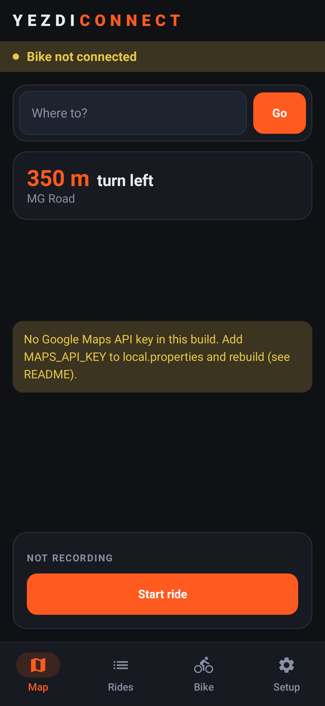
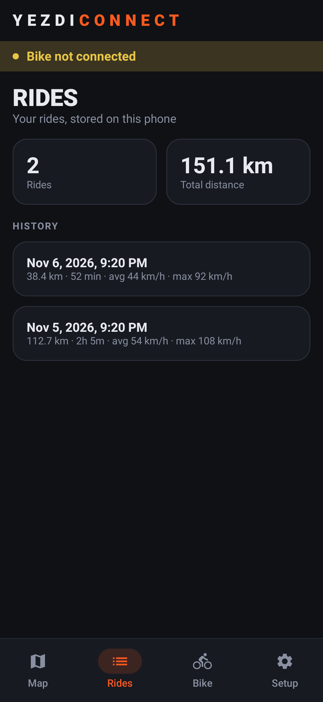
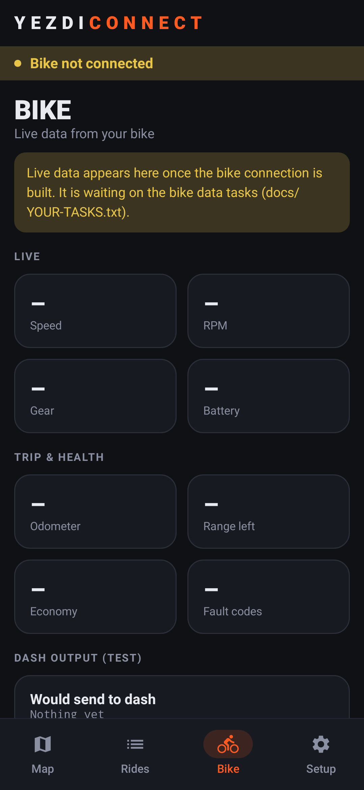
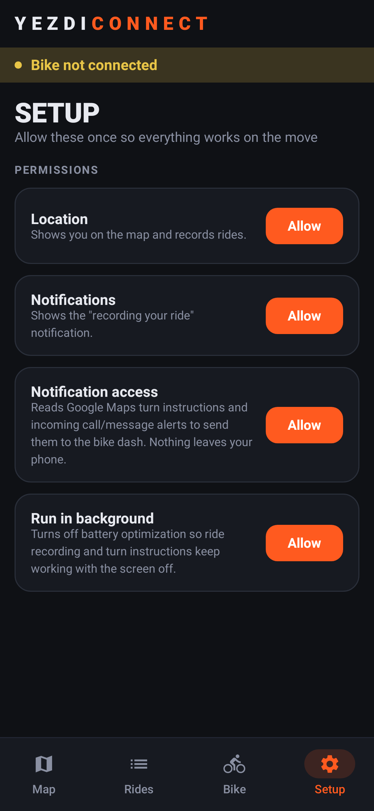

# Yezdi Connect

A light, clean Android companion app for Yezdi motorcycles, built on **Google Maps**.

- **Map**: Google Map with your live location.
- **Navigate**: type a destination and Google Maps starts turn-by-turn in two-wheeler mode.
  The app reads the next turn from Google Maps' navigation notification so it can be shown on the
  bike's dash.
- **Rides**: start/stop ride recording. Route, distance, duration, average and top speed are saved
  on your phone.
- **Bike**: Bluetooth connection, live stats and dash output. *In progress:* the bike's Bluetooth
  protocol is still being mapped (see [docs/YOUR-TASKS.txt](docs/YOUR-TASKS.txt)). Until then this
  tab shows what the app *would* send to the dash.

Everything stays on your phone. There are no accounts and no servers, and the app never talks to
the official app's backends.

> Not affiliated with or endorsed by Classic Legends, Jawa or Yezdi.

<p>
  
  
  
  
</p>

Screenshots are rendered by `ScreensScreenshotTest` at Galaxy M31 size with sample data
(`./gradlew :app:testDebugUnitTest -Pscreenshots`, output in `app/build/screenshots/`).
The design is described in [docs/design-notes.md](docs/design-notes.md).

## Status

| Feature | State |
|---|---|
| Google Map + live location | ✅ |
| Navigate via Google Maps (two-wheeler mode) | ✅ |
| Read Google Maps turn instructions | ✅ (English) |
| Read incoming call / message alerts | ✅ |
| Ride recording + history | ✅ |
| Bluetooth connection to the bike | ⏳ waiting for bike data |
| Live bike stats | ⏳ waiting for bike data |
| Turn arrows / call / SMS on the dash | ⏳ waiting for bike data |

## Building

Requirements: JDK 17+ and the Android SDK (Android Studio installs both).

1. Get a Google Maps API key:
   - In [Google Cloud Console](https://console.cloud.google.com/), create a project and enable
     **Maps SDK for Android**. Google requires a billing account on the project, but showing maps
     in an Android app is free.
   - Create an API key and **restrict it** to Android apps with package name
     `com.yezdiconnect.app` and your signing certificate's SHA-1. Any key inside an APK can be
     extracted, so the restriction is what keeps it from being misused.
2. Put the key in `local.properties` in the project root (this file is git-ignored):
   ```properties
   MAPS_API_KEY=your-key-here
   ```
3. Build and install on a phone connected with USB debugging:
   ```bash
   ./gradlew :app:installDebug
   ```
   Or build only, then find the APK in `app/build/outputs/apk/debug/`:
   ```bash
   ./gradlew :app:assembleDebug
   ```

Run the unit tests:
```bash
./gradlew :app:testDebugUnitTest
```

Without a key the app still builds and runs; the map area shows a message instead of the map.

### CI

GitHub Actions ([.github/workflows/android.yml](.github/workflows/android.yml)) runs the unit tests
and builds a debug APK on every push. Download it from the run's **Artifacts**. To get a working map
in CI builds, add a repository secret named `MAPS_API_KEY`.

## First run on the phone

Open the **Setup** tab and allow:

- **Location**: map position and ride recording.
- **Notifications**: the "recording your ride" notification (Android 13+).
- **Notification access**: lets the app read Google Maps' turn instructions and call/message
  alerts so it can forward them to the dash. They're read on the phone and never stored or uploaded.
- **Run in background**: turns off battery optimization so rides and the dash link keep working
  with the screen off.

**Samsung phones (main target: Galaxy M31, One UI 4 / Android 12).** One UI puts apps to sleep
on top of Android's battery optimization. The Setup tab shows the extra steps: in the app's
settings set **Battery → Unrestricted**, then add Yezdi Connect to **Settings → Battery and device
care → Battery → Background usage limits → Never sleeping apps**.

## Project layout

```
app/src/main/java/com/yezdiconnect/app/
  protocol/   Bike Bluetooth UUIDs (from analysis of the official app)
  nav/        Google Maps notification reader + turn instruction parser
  alerts/     Call / message alert model
  dash/       What gets shown on the bike dash (logging stand-in until the protocol is known)
  rides/      Ride recording service, Room database, distance math
  ui/         Compose screens: Map, Rides, Bike, Setup
```

Built with Kotlin, Jetpack Compose, Google Maps Compose, Play Services Location and Room.
No DI framework or analytics, to keep the app small (release APK ≈ 1.6 MB).
